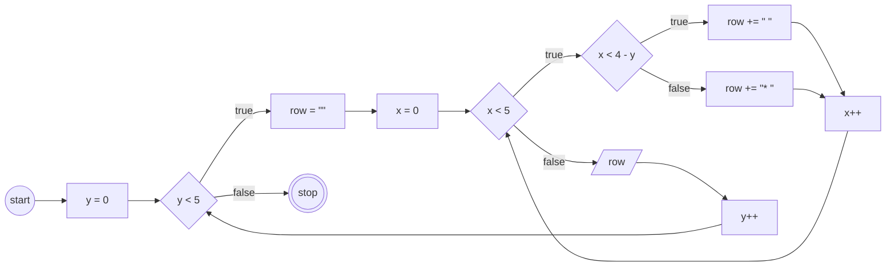
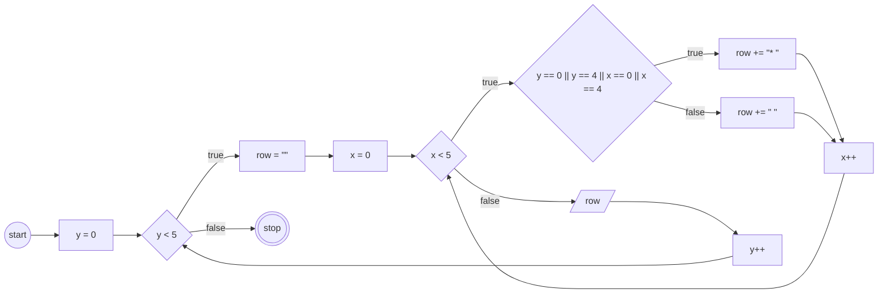

# JavaScript 3

## Program 1

### Pola
```
* * * * *
* * * * *
* * * * *
* * * * *
* * * * *
```

### Flowchart


### Kode
```javascript
for (let y = 0; y < 5; y++) {
    let row = "";
    for (let x = 0; x < 5; x++) {
        row += "* ";
    }
    console.log(row);
}
```

## Program 2

### Pola
```
*
* *
* * *
* * * *
* * * * *
```

### Flowchart


### Kode
```javascript
for (let y = 0; y < 5; y++) {
    let row = "";
    for (let x = 0; x <= y; x++) {
        row += "* ";
    }
    console.log(row);
}
```

## Program 3

### Pola
```
    *
   * *
  * * *
 * * * *
* * * * *
```

### Flowchart


### Kode
```javascript
for (let y = 0; y < 5; y++) {
    let row = "";
    for (let x = 0; x < 5; x++) {
        if (x < 4 - y) {
            row += " ";
        } else {
            row += "* ";
        }
    }
    console.log(row);
}
```

## Program 4

### Pola
```
* * * * *
*       *
*       *
*       *
* * * * *
```

### Flowchart


### Kode
```javascript
for (let y = 0; y < 5; y++) {
    let row = "";
    for (let x = 0; x < 5; x++) {
        if (y === 0 || y === 4 || x === 0 || x === 4) {
            row += "* ";
        } else {
            row += "  ";
        }
    }
    console.log(row);
}
```