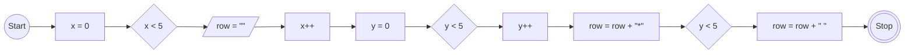
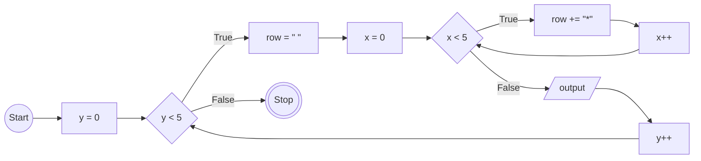

# JavaScript 3

## Membuat Program Menggambar Bintang Lima Horizontal dan Lima Vertikal

### Flowchart


### Kode
```
for (let y = 0; y < 5; y++) {
    let row = "";
    for (let x = 0; x < 5; x++) {
        row = row + "* ";
    }
    console.log(row);
}
```

## Membuat Program Menggambar Bintang Semakin ke Bawah Semakin Bertambah

### Flowchart


### Kode
```
for (let y = 0; y < 5; y++) {
    let row = "";
    for (let x = 0; x <= y; x++) {
        row = row + "* ";
    }
    console.log(row);
}
```