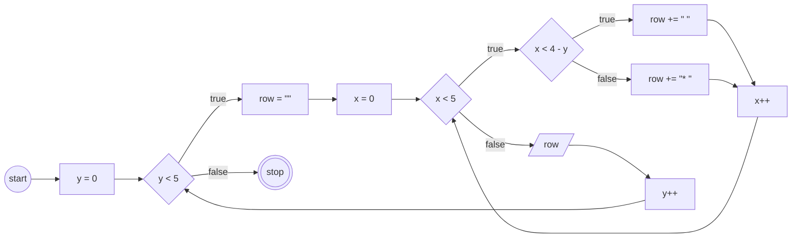

# JavaScript 3

## Program 1

### Pola
```
* * * * *
* * * * *
* * * * *
* * * * *
* * * * *
```

### Flowchart


## Program 2

### Pola
```
*
* *
* * *
* * * *
* * * * *
```

### Flowchart


## Program 3

### Pola
```
    *
   * *
  * * *
 * * * *
* * * * *
```

### Flowchart


## Program 4

### Pola
```
* * * * *
*       *
*       *
*       *
* * * * *
```

### Flowchart

