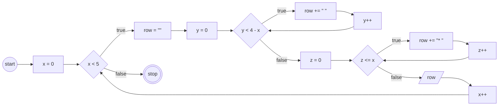

# JavaScript 3

## Program 1

### Pola
```
* * * * *
* * * * *
* * * * *
* * * * *
* * * * *
```

### Flowchart


## Program 2

### Pola
```
*
* *
* * *
* * * *
* * * * *
```

### Flowchart


## Program 3

### Pola
```
    *
   * *
  * * *
 * * * *
* * * * *
```

### Flowchart


## Program 4

### Pola
```
* * * * *
*       *
*       *
*       *
* * * * *
```

### Flowchart
```mermaid
flowchart LR
    A((start))
    B[x = 0]
    C{x < 5}
    D[row = #quot;#quot;]
    E[y = 0]
    F{y < 5}
    G{x == 0 || x == 4 || y == 0 || y == 4}
    H[row += #quot;* #quot;]
    I[row += #quot;  #quot;]
    J[y++]
    K[/row/]
    L[x++]
    Z(((stop)))

    A --> B
    B --> C
    C --true--> D
    D --> E
    E --> F
    F --true--> G
    G --true--> H
    G --false--> I
    H --> J
    I --> J
    J --> F
    F --false--> K
    K --> L
    L --> C
    C --false--> Z
```